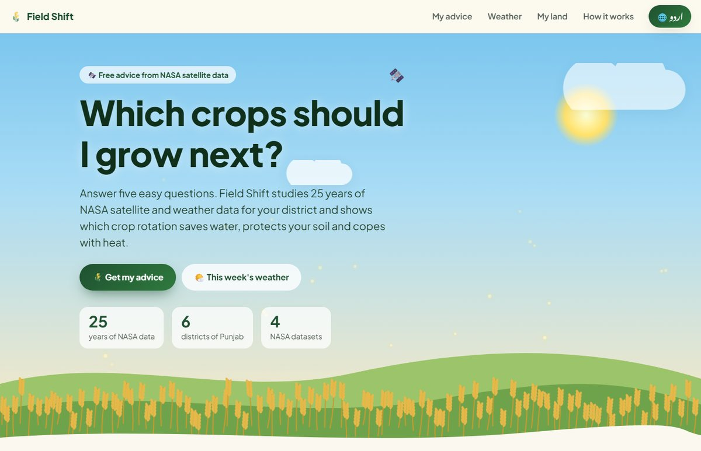
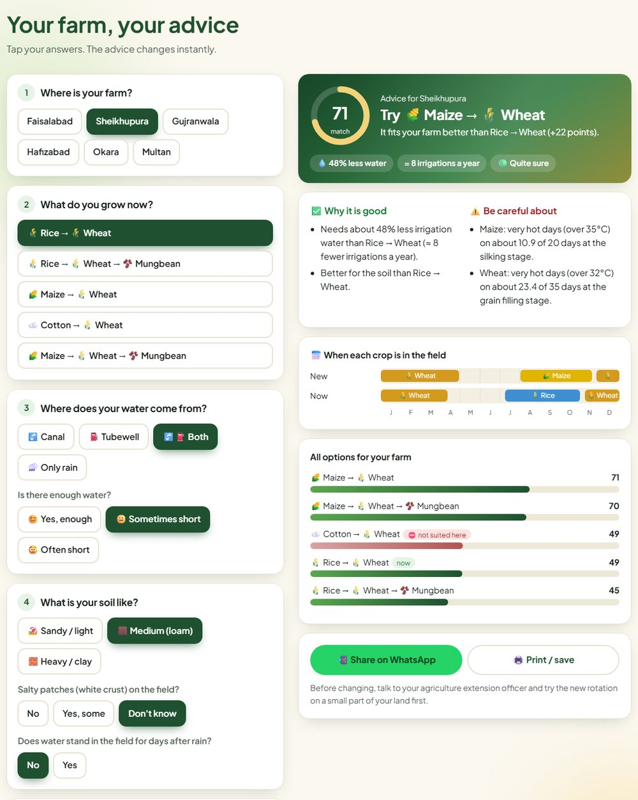
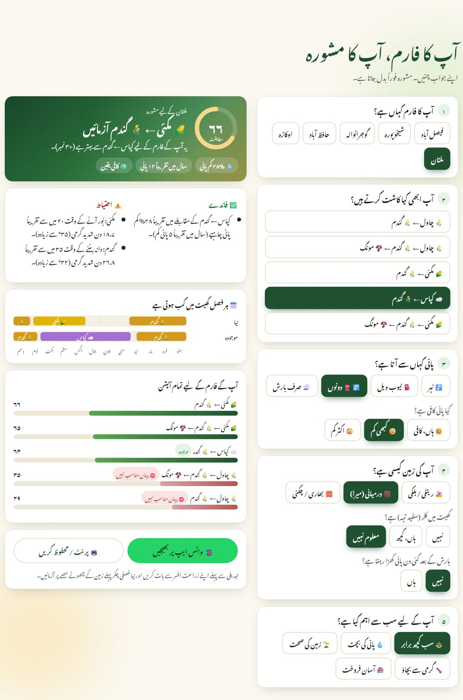
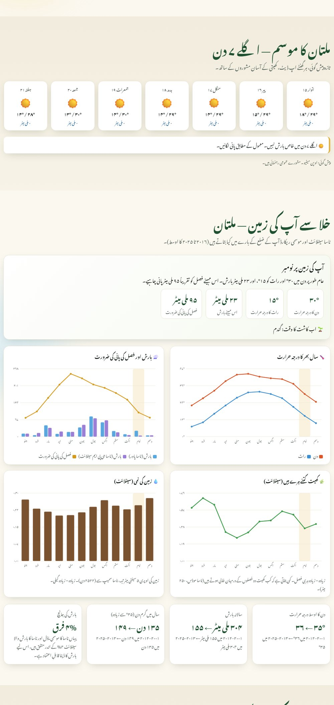
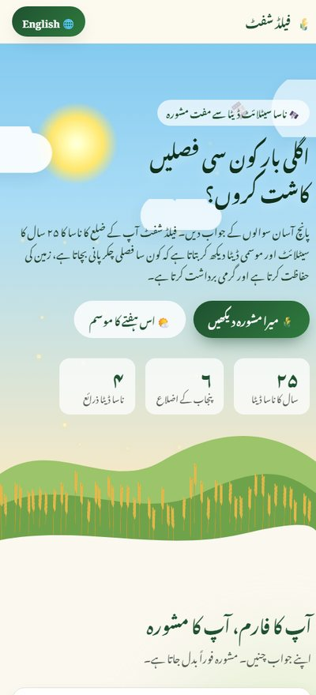
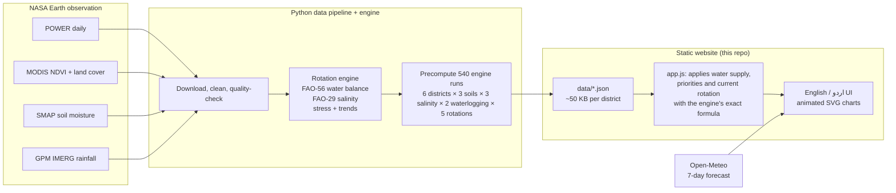

<div align="center">

# 🌾 Field Shift

### Crop-rotation advice for farmers in Punjab, Pakistan — from 25 years of NASA satellite data

**English · اردو** &nbsp;|&nbsp; Free &nbsp;|&nbsp; No sign-up &nbsp;|&nbsp; Works on any phone

**[🌐 Open the live website → hassancodes-max.github.io/fieldshift](https://hassancodes-max.github.io/fieldshift/)**



</div>

---

## Contents

- [The problem](#-the-problem)
- [What Field Shift does](#-what-field-shift-does)
- [Screenshots](#-screenshots)
- [NASA data used](#-nasa-data-used)
- [The science](#-the-science)
- [The decision engine](#-the-decision-engine)
- [Architecture](#-architecture)
- [Tech stack](#-tech-stack)
- [Security, privacy and performance](#-security-privacy-and-performance)
- [Quality and testing](#-quality-and-testing)
- [Run it locally](#-run-it-locally)
- [Repository layout](#-repository-layout)
- [Limitations](#-limitations)
- [Data sources and references](#-data-sources-and-references)

---

## 🚜 The problem

Punjab's dominant **rice → wheat** rotation feeds millions, but it comes at a cost:

- 💧 **Groundwater is falling.** Puddled rice is one of the thirstiest crops in the region.
- 🌡️ **Heat stress is rising** at the stages that matter most, such as wheat grain filling and rice flowering.
- 🔥 **Burning rice straw** damages soil and feeds the winter smog.

Better rotations exist (maize–wheat, adding mungbean, cotton–wheat in the south), but the data needed to compare them
(satellite climate records, crop water models, soil science) is locked away in scientific formats. **Field Shift turns
that data into a clear answer a farmer can read on a phone, in their own language.**

## ✨ What Field Shift does

A farmer answers **5 tap-to-answer questions**:

| # | Question | Options |
|---|---|---|
| 1 | Where is your farm? | Faisalabad, Sheikhupura, Gujranwala, Hafizabad, Okara, Multan |
| 2 | What do you grow now? | 5 common rotations |
| 3 | Where does your water come from, and is it enough? | Canal / tubewell / both / rain only × enough / sometimes short / often short |
| 4 | What is your soil like? | Sandy / medium / heavy, salty patches, waterlogging |
| 5 | What matters most? | Balanced, save water, healthy soil, safe from heat, easy to sell |

…and **instantly** gets:

- ✅ **The best-fitting rotation** with a 0–100 match score and an animated comparison of all options
- 💧 **Water saving** versus the current rotation, in % and in number of irrigations per year
- ⚠️ **Benefits and risks in plain words**, such as heat at flowering, salinity yield loss, the wrong agro-ecological zone or straw burning
- 📅 **A crop calendar** showing when each crop occupies the field, now versus the suggestion
- 🟢 **A confidence level** ("Quite sure" / "Fairly sure" / "Not sure — check locally")
- 🌤️ **A live 7-day forecast** with farm tips (skip an irrigation before rain, heat and frost warnings)
- 🛰️ **"Your land from space":** monthly temperature, rain vs. crop water need, satellite greenness, satellite soil moisture and 25-year climate trends
- 📲 **WhatsApp sharing** and printing. The answers live in the URL, so a shared link opens with the same farm.
- 🌐 **Full Urdu mode:** every word, number, unit, month and chart label switches to Urdu, right to left, with Urdu numerals (۰۱۲۳).

## 📸 Screenshots

| Advice (English) | Advice (اردو) |
|---|---|
|  |  |

| NASA data and live weather (اردو) | On a phone |
|---|---|
|  |  |

## 🛰️ NASA data used

| Dataset | What it measures | Resolution / period | How it is used |
|---|---|---|---|
| **NASA POWER** (daily, Agroclimatology) | Max/min temperature, rain, humidity, solar radiation, wind, soil wetness (MERRA-2) | 0.5° × 0.625°, daily, 2001 → today | Drives the daily crop water balance and heat/frost/heavy-rain stress for every crop, plus the 25-year trends |
| **MODIS MOD13Q1** (Terra) | NDVI vegetation greenness | 250 m, every 16 days, 2015 → today | Finds when fields are green and when they are bare between crops; checks rotation timing against what satellites actually see |
| **MODIS MCD12Q1** | IGBP land-cover class | 500 m, yearly (2023) | Confirms each district point really is cropland (one point was moved because it wasn't) |
| **SMAP SPL3SMP_E v006** | Surface soil moisture (top ~5 cm) | 9 km, daily, 2015 → today | Monthly soil-moisture pattern for each district, with SMAP's own quality flag |
| **GPM IMERG Final V07** (monthly) | Satellite precipitation | 0.1°, monthly, 2001 → today | Independent check of POWER rainfall. They agree within **±10%** in all six districts (monthly correlation r = 0.72–0.95). |

Data access: POWER REST API, ORNL DAAC MODIS web service, NASA AppEEARS (SMAP) and GES DISC OPeNDAP (IMERG), with an
Earthdata login for SMAP and IMERG.

## 🧮 The science

- **Reference evapotranspiration**: FAO-56 **Hargreaves** equation from POWER temperature and extraterrestrial radiation.
- **Crop water use**: FAO-56 single crop coefficients (Kc initial / mid / end) over each crop's growth stages.
- **Daily soil-water balance** per crop and per year: rain, crop water use, root-zone storage by soil texture,
  depletion fractions, plus rice land preparation and percolation. The result is a **net irrigation need** in mm and in
  3-inch farmer irrigations.
- **Salinity**: FAO-29 (Ayers & Westcot) yield-potential model, `Y = 100 − b·(ECe − a)`, per crop.
- **Climate stress**: crop-specific thresholds at sensitive stages, for example wheat grain filling above 32 °C,
  rice flowering above 35 °C, frost nights and heavy-rain days (≥ 40 mm), counted on the real weather of each year.
- **Trends**: linear trend per decade and early-vs-late period means for temperature, rain, hot days and monsoon rain.
- **NDVI**: cleaned and gap-filled MODIS series → climatology → automatic detection of low-vegetation (bare) windows.

## 🧠 The decision engine

Field Shift deliberately uses **no black-box model**. It is an **explainable multi-criteria decision engine**:

1. **Schedule**: place each crop of the rotation in its regional sowing window and detect late sowing, overlaps
   and bare days.
2. **Simulate**: replay the rotation on the **actual NASA weather of each of the last 10 complete years**.
3. **Score 6 factors (0–100)**:

   | Factor | Based on |
   |---|---|
   | 💧 Water saving | Net irrigation need, penalised if it exceeds what the farmer's water supply can deliver |
   | 🌱 Soil health | Legumes, crop-family diversity, puddling, straw burning, bare days |
   | 🌡️ Climate resilience | Heat / frost / heavy-rain days at sensitive stages, and the trend in heat days |
   | 🧪 Soil & local fit | Texture suitability, FAO-29 salinity yield potential, waterlogging, agro-ecological zone |
   | 📅 Calendar fit | Days of late sowing; whether the sequence fits in one year |
   | 🏪 Market | Local market access per crop |

4. **Weight** the factors by the farmer's priority (for example "save water" gives water ×8).
5. **Hard gates**: deal-breakers (a crop outside its agro-ecological zone, a sequence that does not fit in a year)
   cut the total by 30%, so they cannot be averaged away.
6. **Explain**: every result comes with its evidence, benefits, risks and a confidence level based on data
   completeness (years of weather, NDVI, SMAP, soil test, market knowledge).

## 🏗️ Architecture



Factor scores do not depend on the farmer's priorities or current rotation, so the engine is run **ahead of time**
for every combination of the questions that change them. The browser then applies the water-supply penalty,
the priority weights and the comparison with the current rotation, **using the same formula as the Python engine**.
The result is a website that needs no server, loads in about a second and answers instantly.

## 🧰 Tech stack

| Layer | Tools |
|---|---|
| Data pipeline and engine | **Python**: pandas, NumPy, requests; NASA POWER API, ORNL DAAC, AppEEARS, GES DISC OPeNDAP; Earthdata login with retries and mirror fallback |
| Analysis app (desktop) | Streamlit, Plotly and Folium for detailed exploration, custom map locations and what-if climate scenarios |
| Website | **Vanilla HTML / CSS / JavaScript**, no framework and no chart library. Charts are hand-built animated SVG. |
| Design | CSS animations (sky, drifting clouds, orbiting satellite, swaying wheat, pollen), scroll reveal, count-up numbers, `prefers-reduced-motion` support |
| Languages | Complete English / Urdu dictionaries, RTL layout, Urdu numerals, Noto Nastaliq Urdu font |
| Live weather | Open-Meteo forecast API (free, no key), cached for 1 hour |
| Hosting | **GitHub Pages**: global CDN, HTTPS enforced |
| Testing | pytest: 31 automated tests |

## 🔒 Security, privacy and performance

- **HTTPS only** (GitHub Pages, enforced).
- **Strict Content-Security-Policy**: scripts only from this site; network calls only to this site and Open-Meteo;
  no `eval`, no third-party scripts, no trackers, no cookies, no analytics.
- All text is inserted with `textContent` (never `innerHTML`), so nothing a user does can inject code.
- **No personal data** is collected. Answers stay in the browser (localStorage and the URL).
- **No secrets**: NASA Earthdata logins are used only offline by the data pipeline, never by the website.
- **Fast**: the whole site is about 400 KB, the other districts preload in the background, and every answer is computed
  instantly in the browser.
- **Accessible**: keyboard-friendly buttons with `aria-pressed`, a skip link, a live region for the advice, large tap
  targets (≥ 48 px) and reduced motion when the device asks for it.

## ✅ Quality and testing

31 automated tests in the source project, including:

- **Website = engine:** random answer combinations are scored by the Python engine and by the website's formula, and must match.
- **Every text translated:** every English key has an Urdu twin, every key used by the page exists, and no English words appear in Urdu mode.
- All **80 buildable rotations** run through the engine without errors; profile validation; FAO formula checks.
- NASA data integrity: grid indexing, unit conversion, IMERG cross-check, SMAP quality flags, land-cover cropland check.
- Download robustness: retries, login-failure detection and network outages.

## 💻 Run it locally

The website is plain static files, so any web server works:

```bash
git clone https://github.com/HassanCodes-max/fieldshift.git
cd fieldshift
python -m http.server 8000
# open http://localhost:8000
```

(Opening `index.html` directly from disk will not load the data, because browsers block `fetch` on `file://`.)

## 📁 Repository layout

```
index.html        page structure (every text is filled in by i18n.js)
style.css         design, animations, RTL and print styles
i18n.js           complete English and Urdu text
app.js            scoring, rendering, weather, SVG charts, hero animation
data/meta.json    crops, rotations, districts, engine constants
data/region_*.json  precomputed engine results + NASA climate summary per district
assets/           README screenshots
```

## ⚠️ Limitations

- NASA data describes a **district-scale area** (250 m to 50 km pixels), not one particular field.
- The website covers **6 representative districts**. Custom locations are available in the desktop analysis app.
- Results compare the **relative suitability** of rotations under documented assumptions. They are **not** yield,
  profit or exact water-saving predictions.
- Crop calendars and thresholds are regional guidance. **Always confirm with your local agriculture extension
  officer** and try a new rotation on a small part of the farm first.

## 📚 Data sources and references

- NASA POWER Project, NASA Langley Research Center — https://power.larc.nasa.gov
- Didan, K. (2021). MODIS/Terra Vegetation Indices 16-Day L3 Global 250m SIN Grid (MOD13Q1) V061. NASA EOSDIS LP DAAC.
- Friedl, M., Sulla-Menashe, D. (2022). MODIS/Terra+Aqua Land Cover Type Yearly L3 Global 500m (MCD12Q1) V061. NASA EOSDIS LP DAAC.
- O'Neill, P. E., et al. SMAP Enhanced L3 Radiometer Global Daily 9 km EASE-Grid Soil Moisture (SPL3SMP_E), Version 6. NASA NSIDC DAAC.
- Huffman, G. J., et al. GPM IMERG Final Precipitation L3 1 month 0.1° (GPM_3IMERGM) V07. NASA GES DISC.
- MODIS subsets via ORNL DAAC MODIS Web Service; SMAP via NASA AppEEARS.
- Allen, R. G., Pereira, L. S., Raes, D., Smith, M. (1998). *Crop evapotranspiration*, FAO Irrigation and Drainage Paper 56.
- Ayers, R. S., Westcot, D. W. (1985). *Water quality for agriculture*, FAO Irrigation and Drainage Paper 29 Rev. 1.
- Weather forecast: Open-Meteo.com (CC BY 4.0).

---

<div align="center">

**Field Shift supports, but does not replace, the advice of your local agriculture extension officer.**

فیلڈ شفٹ مددگار ہے، لیکن اپنے محکمہ زراعت کے افسر کے مشورے کا متبادل نہیں۔

</div>
